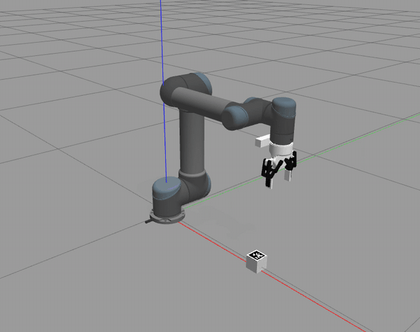

# UR5 + Robotiq 2F-85 — ROS 1 Noetic / Gazebo 11 / MoveIt 1

Pick and place with a UR5, a Robotiq 2F-85 gripper and AprilTag detection on a wrist camera, in Gazebo. Everything
runs in a Docker container (Ubuntu 20.04 image), so the host can be any Linux with Docker. The ROS 2 port of this
project is [mates1414/robotic_arm_ros2](https://github.com/mates1414/robotic_arm_ros2).



*`pick_place_demo.py _use_apriltag:=true` in Gazebo, 2x speed: the cube position comes from the AprilTag seen by
the wrist camera.*

| | this repo | ROS 2 port |
|---|---|---|
| ROS | Noetic (EOL 05/2025, final release) | Jazzy (LTS, until 05/2029) |
| Simulator | Gazebo 11 (Classic) | Gazebo Harmonic |
| Motion planning | MoveIt 1.1, `moveit_commander` (Python) | MoveIt 2, `MoveGroupInterface` (C++) |
| Grasp in simulation | own `grasp_attacher` plugin | gz-sim `DetachableJoint` |
| UR / Robotiq upstream | apt binaries; 2F-85 model in `ur5_robotiq_description` | apt binaries, nothing vendored |

Noetic is end of life. The image installs from `snapshots.ros.org/noetic/final`, the frozen final state of the Noetic
repository, so every package is at its last release (e.g. MoveIt 1.1.16, `ur_robot_driver` 2.4.1,
`universal_robots` 1.5.0).

## Upstream packages (apt)

| Package | Source | Used for |
|---|---|---|
| `ur_description`, `ur_gazebo` | [ros-industrial/universal_robot](https://github.com/ros-industrial/universal_robot) | UR5 URDF macro, meshes, Gazebo control launch file |
| `ur_robot_driver` | [UniversalRobots/Universal_Robots_ROS_Driver](https://github.com/UniversalRobots/Universal_Robots_ROS_Driver) | the real robot later (installed, not used yet) |
| `roboticsgroup_upatras_gazebo_plugins` | [roboticsgroup/roboticsgroup_upatras_gazebo_plugins](https://github.com/roboticsgroup/roboticsgroup_upatras_gazebo_plugins) | mimic joints of the gripper in Gazebo |
| `apriltag_ros` | [AprilRobotics/apriltag_ros](https://github.com/AprilRobotics/apriltag_ros) | tag detection |
| `moveit`, `trac_ik_kinematics_plugin`, `gazebo_ros_control`, `ros_controllers` | moveit, traclabs, ros-simulation, ros-controls | |

[ros-industrial/robotiq](https://github.com/ros-industrial/robotiq) was never released for Noetic. The 2F-85 model
(kinematics, inertias, meshes) is therefore part of `ur5_robotiq_description`; the gripper driver for the real
hardware would have to be built from source.

## Packages

| Package | Contents |
|---|---|
| `ur5_robotiq_description` | `ur5_robotiq.urdf.xacro`: UR5 + 2F-85 + `grasp_link` TCP + wrist camera + grasp attachment, `view.launch` |
| `ur5_robotiq_gazebo_plugins` | `grasp_attacher`: fixes the grasped object to the wrist on request (Gazebo 11 plugin, C++) |
| `ur5_robotiq_moveit_config` | SRDF (`manipulator`, `gripper`; `home`, `up`, `open`, `closed`), OMPL/Pilz/CHOMP, `move_group.launch`, `moveit_rviz.launch` |
| `ur5_robotiq_bringup` | `sim.launch`, `sim_moveit.launch`, `apriltag.launch`, controllers, `worlds/ur5_workcell.world`, `models/apriltag_cube` |
| `ur5_robotiq_manipulation` | `pick_place_demo.py` (moveit_commander), fixed or AprilTag pick position |

## Quick start

```bash
./docker/run.sh --build     # once: builds the ur5_ros1:noetic image (~6.5 GB)
./docker/run.sh             # shell in the container (started on demand), at the workspace root

# in the container
catkin build
source devel/setup.bash
roslaunch ur5_robotiq_bringup sim_moveit.launch               # Gazebo + MoveIt + RViz
# second shell (./docker/run.sh):
rosrun ur5_robotiq_manipulation pick_place_demo.py
```

The demo moves the cube from (0.5, 0) to (0.4, -0.3). Its poses are private parameters: `_pick_x`, `_pick_y`,
`_place_x`, `_place_y`, `_grasp_z`, `_approach_z`, `_grasp_position` (`finger_joint` angle at the grasp).

With AprilTag detection the pick position comes from the tag on the cube, seen by the wrist camera from the `home`
pose:

```bash
roslaunch ur5_robotiq_bringup sim_moveit.launch apriltag:=true
rosrun ur5_robotiq_manipulation pick_place_demo.py _use_apriltag:=true
```

Other entry points:

```bash
roslaunch ur5_robotiq_bringup sim.launch                      # Gazebo + controllers + RViz, no MoveIt
roslaunch ur5_robotiq_bringup apriltag.launch                 # detection only (/tag_detections, TF tag_0)
roslaunch ur5_robotiq_description view.launch                 # model only, joint sliders
roslaunch ur_gazebo ur5_bringup.launch                        # bare upstream UR5, no gripper
```

## Docker

`docker/run.sh` keeps one container (`ur5_ros1_dev`) running and `exec`s into it. The repository is mounted at
`~/robotic_arm` in the container, the user has the host UID/GID, X11 is forwarded and `/dev/dri` and the NVIDIA GPU
(when nvidia-container-toolkit is installed) are passed in. Host networking; the ROS master is
`http://localhost:11311` unless `ROS_MASTER_URI` is set on the host (`ROS_MASTER_URI=http://localhost:11312
./docker/run.sh` when another ROS 1 setup uses the default port).

`./docker/run.sh <command>` runs a command in the container with the environment loaded, `./docker/run.sh --stop`
removes the container. `rosdep` skips end-of-life distributions unless asked, so use
`rosdep install --from-paths src --ignore-src --rosdistro noetic --include-eol-distros` when adding dependencies.

## Without Docker (Ubuntu 20.04 + ROS Noetic)

With [ROS Noetic](http://wiki.ros.org/noetic/Installation/Ubuntu) (`ros-noetic-desktop-full`) installed, the
repository is the catkin workspace:

```bash
git clone https://github.com/mates1414/robotic_arm.git ~/robotic_arm && cd ~/robotic_arm
source /opt/ros/noetic/setup.bash
sudo apt install python3-catkin-tools python3-rosdep
sudo rosdep init                                   # only if rosdep was never initialized
rosdep update --rosdistro noetic --include-eol-distros
rosdep install --from-paths src --ignore-src -y --rosdistro noetic
catkin build
source devel/setup.bash
```

Then continue with the `roslaunch` commands of the quick start. Noetic packages are only available for Ubuntu 20.04;
on other releases use Docker.

## Topics

| Topic | Type | |
|---|---|---|
| `/pos_joint_traj_controller/follow_joint_trajectory` | `control_msgs/FollowJointTrajectory` | arm |
| `/gripper_controller/gripper_cmd` | `control_msgs/GripperCommand` | gripper, 0.0 open … 0.8 closed |
| `/ur5/grasp/attach`, `/ur5/grasp/detach` | `std_msgs/Empty` | grasp attachment in Gazebo |
| `/ur5/grasp/state` | `std_msgs/String` (latched) | `attached` / `detached` |
| `/ur5/wrist_camera/image_raw`, `/ur5/wrist_camera/camera_info` | `sensor_msgs/Image`, `CameraInfo` | wrist camera, 640x480, 30 Hz |
| `/tag_detections`, `/tag_detections_image` | `apriltag_ros/AprilTagDetectionArray`, `sensor_msgs/Image` | AprilTag |

## Gripper and grasping in Gazebo

* Only `finger_joint` is commanded (`position_controllers/GripperActionController`). The five other joints follow it
  through the mimic plugin; Gazebo 11 ignores the URDF `<mimic>` tags, which are there for MoveIt and
  `robot_state_publisher`. With the gripper at 0.37 rad the pads are 5 cm apart.
* The arm uses the position interface (`pos_joint_traj_controller` of `ur_gazebo`), not the upstream default effort
  interface: the mimic plugin sets the finger joints kinematically every step, and the effort-controlled wrist does
  not hold still against that.
* Friction alone does not hold objects reliably in Gazebo (the open problem of the earlier version of this repo, see
  the git history). `grasp_attacher` in the URDF fixes the model named by the xacro argument `grasp_object` (default
  `apriltag_cube`) to `wrist_3_link` at its current pose when `std_msgs/Empty` arrives on `/ur5/grasp/attach`, and
  releases it on `/ur5/grasp/detach`. The demo closes the gripper to the cube's width, attaches, and on release opens
  first, then detaches.

## Known pitfalls

* Gazebo starts paused and `spawn_model` unpauses it once the start joint positions are set (`sim.launch`).
  Otherwise the arm falls before the controllers run and they hold it wherever it landed (this also happens with the
  bare `ur_gazebo` launch files).
* The tag texture has a white border of one cell, so the black square on the 5 cm face is 4 cm: `size: 0.04` in
  `config/apriltag_tags.yaml`.
* The gripper's linkage links touch each other by design; their pairs are excluded from collision checking in the
  SRDF. The rest of the collision matrix comes from
  `rosrun moveit_setup_assistant collisions_updater --urdf <urdf> --srdf <srdf> --output <srdf>`; rerun it after
  changing the URDF.

## Next steps

1. Cube as a MoveIt collision object, attached to the gripper during transport.
2. Real UR5 (CB3, PolyScope ≥ 3.14.3) with `ur_robot_driver` and a Robotiq driver built from source.

## License

MIT (see [LICENSE](LICENSE)), except `ur5_robotiq_description`: its Robotiq 2F-85 model comes from
icl_ur5_setup_description, which is GPL-3.0 ([src/ur5_robotiq_description/LICENSE](src/ur5_robotiq_description/LICENSE)).
